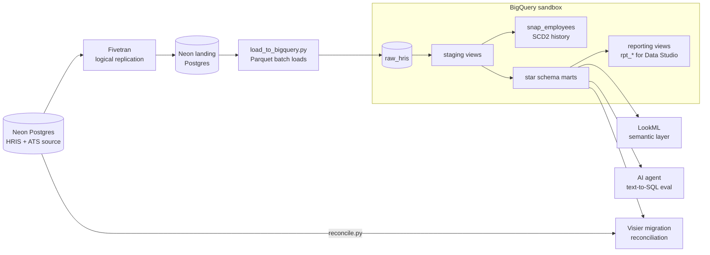
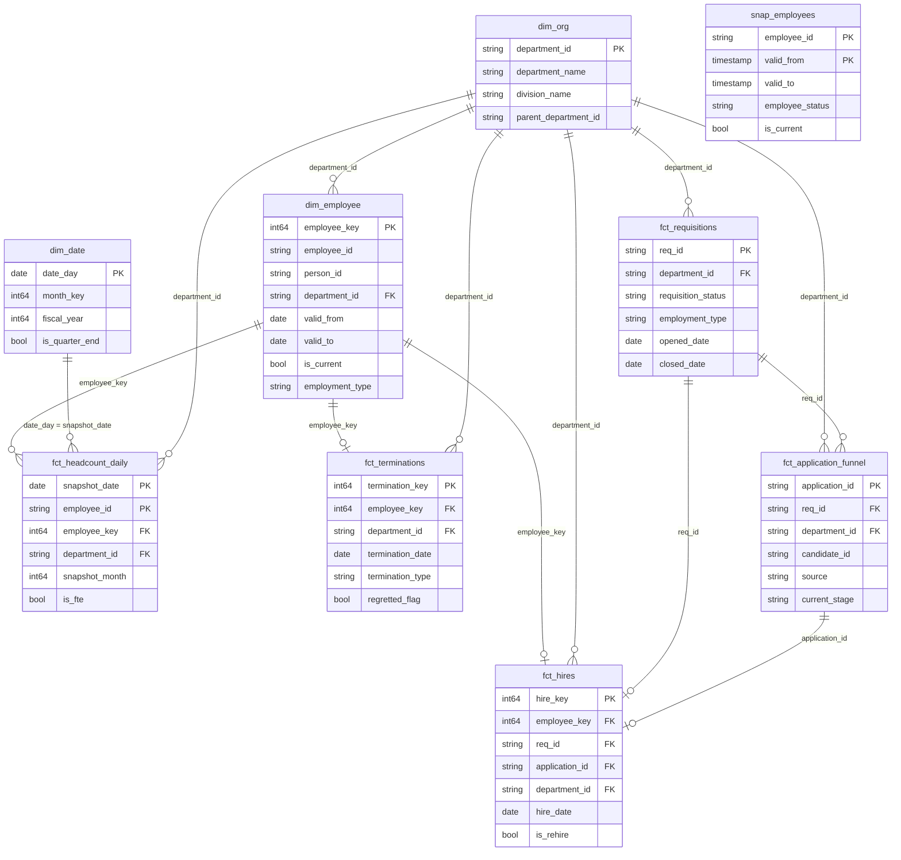
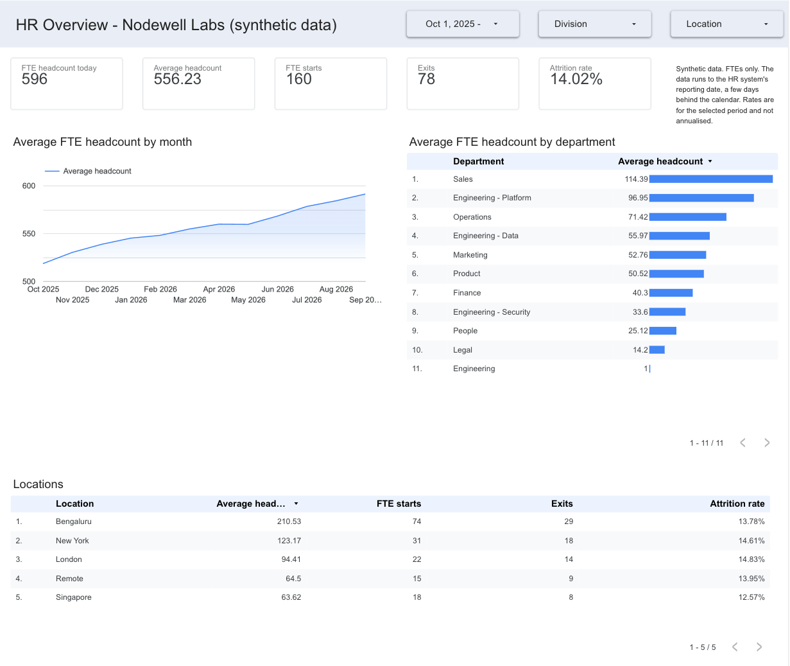
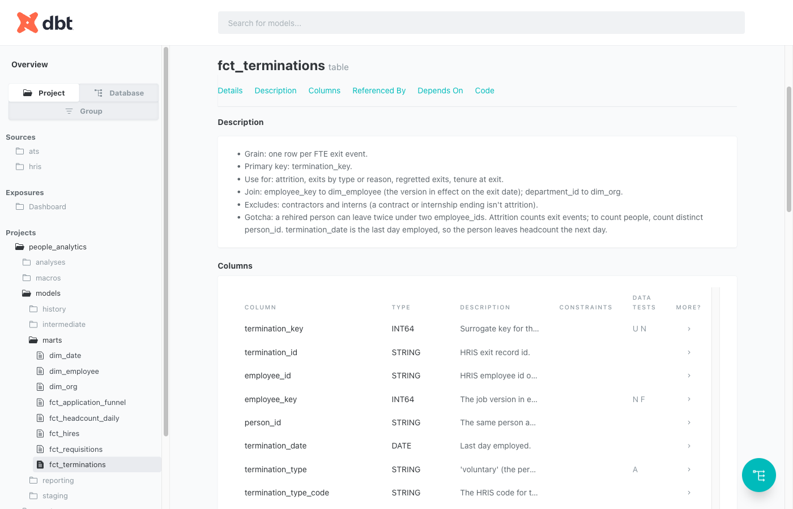
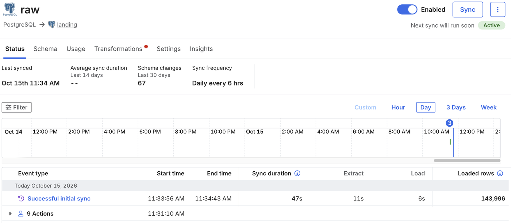
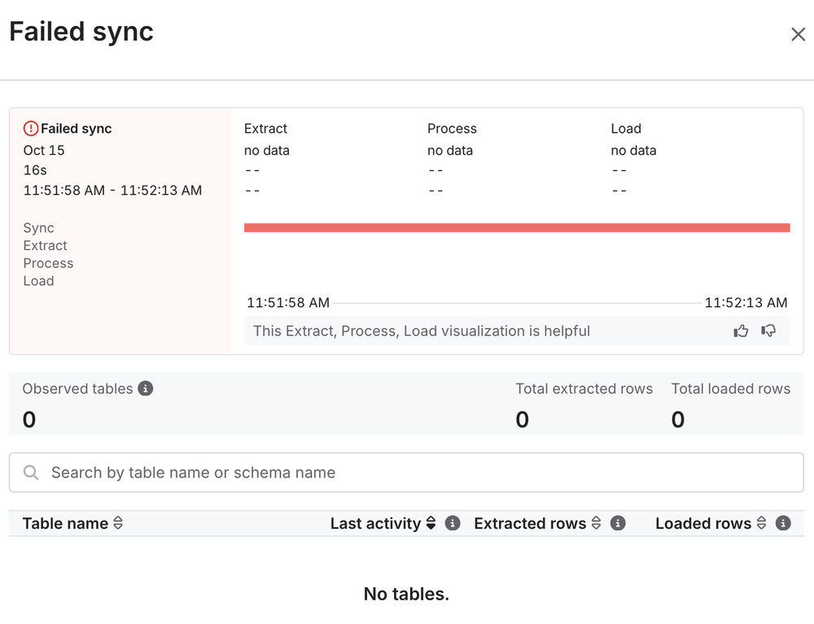
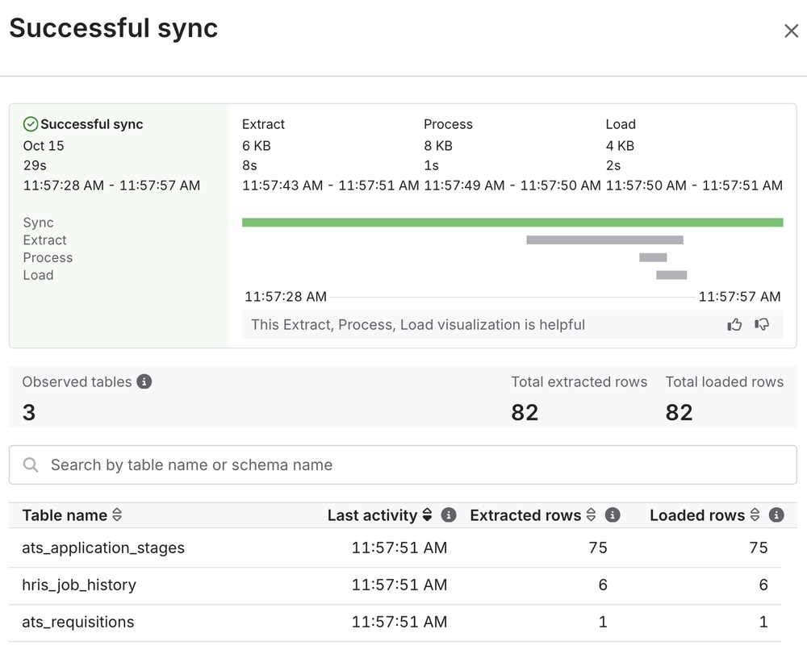

# People-Analytics Warehouse

> **All data in this project is synthetic.** It is generated by a script for a fictional company
> ("Nodewell Labs") as a personal portfolio project. No real people, employers or HR records are involved.

A people-analytics warehouse for HR data moving off a Visier-style tool and onto BigQuery. Nodewell Labs
grows from 350 to about 600 full-time employees over three years of HRIS and ATS history (2023-10-01 to
2026-09-30). The simulated HRIS and ATS in Postgres are replicated by Fivetran, batch-loaded into
BigQuery and modelled with dbt into a documented star schema, so that people (through a LookML semantic layer and reporting views) and AI
agents (through documentation they read before writing SQL) get the same, correct answer. A migration
rehearsal reconciles the warehouse's metrics against the source and against Visier's published
definitions. The pipeline runs at no cost and with no payment card: the BigQuery sandbox, Fivetran's
Free plan, Neon's free plan and GitHub Actions ([decisions](docs/decisions.md)). The text-to-SQL eval
runs on an existing Claude subscription, so it adds no per-call cost.

What it demonstrates:

- **Moving HR data off Visier to BigQuery:** a 48-row inventory in Visier's terms, a migration plan,
  and closed periods reconciled at two levels: 30 of 30 checks against the source, and Visier's
  published definitions emulated with every difference explained. There is no Visier tenant here.
- **Fivetran sync failures and schema drift:** live logical replication, two sync-failure drills
  (one a table Fivetran dropped while reporting a successful sync), and a schema contract that stops
  a renamed or retyped column at the raw layer.
- **Dimensional modelling in BigQuery:** a dbt star schema with an SCD2 employee dimension, facts at
  declared grains and 131 data tests.
- **LookML and dashboards:** a LookML model (8 views, 3 explores) checked by an offline validator,
  because Looker has no free tier, and a four-page Data Studio (formerly Looker Studio) dashboard whose
  tiles were checked against SQL.
- **Documentation for people and AI agents:** every mart column documented; with the docs, an agent
  answering 20 HR questions in SQL went from 7 correct to 17.

## What runs

[](https://github.com/ayush-ranjan-official/people-analytics-warehouse/actions/workflows/dbt.yml)

| Part | How it runs | Latest result |
| --- | --- | --- |
| Fivetran replication | Neon source to a Neon landing database, logical replication every 6 hours; `make ingest` copies the landing schema into BigQuery | Initial sync: 8 tables, 143,996 rows, every count matching the source. `make check-ingestion`: source, landing and BigQuery agree |
| Nightly build and tests | GitHub Actions at 01:23 UTC: load BigQuery, rebuild and test prod, report storage and, unless `PAUSE_SIMULATION` is set, report source freshness and simulate the next HR business day. The simulation was paused on 2026-10-15, so every figure in these docs can be reproduced | 2 seeds, 21 models and 131 data tests, all passing |
| Documentation | `make docs`: dbt docs, the agent's schema context, a coverage check | 8 mart models and 132 columns: 140 of 140 documented |
| LookML checks | `make validate-lookml`: an offline validator written for this repo, because Looker has no free tier | 8 views, 3 explores, 8 dashboard tiles: 0 errors, 0 warnings |
| Data Studio dashboard | HR Overview: 4 pages over the reporting views, kept private to protect the sandbox's free query allowance (screenshots below) | Every Q3 2026 tile and the 2025 funnel match SQL on the views; Division = Engineering matches on Workforce (6.59%) and Recruiting |
| Text-to-SQL eval | `make eval` | 7/20 bare schema, 17/20 documented, 20/20 improved (in-sample); held-out 4/8, 8/8, 8/8 |
| Visier reconciliation | `make migration-check` | Same definitions, source vs warehouse: 30 of 30 checks PASS (22 month-end headcounts, 8 period metrics). Visier's definitions: 6 PASS, 6 EXPLAINED to a zero residual, 0 FAIL |
| Drills | `make drill NAME=...` | 3 schema-drift drills, each caught by the contract test; 2 live Fivetran drills, including a table dropped from replication that Fivetran reported as a successful sync and `make check-ingestion` caught |

## Architecture



Fivetran can't write to a BigQuery sandbox, so it lands in a second Postgres database and a batch loader
copies each table into BigQuery with Fivetran's `_fivetran_synced` and `_fivetran_deleted` columns
([D2](docs/decisions.md#d2-fivetran-lands-in-a-neon-postgres-landing-database-a-batch-loader-moves-it-to-bigquery)).
The sandbox has no DML, drops date partitions older than 60 days, expires tables after 60 days and
allows 10 GiB of storage for the project's lifetime, and the models are built around those limits
([D6](docs/decisions.md#d6-dbt-models-are-designed-around-the-sandbox-limits)). The layers, the rule
each enforces, where problems are caught and how the nightly run works are in
[docs/architecture.md](docs/architecture.md).

## Data model



| Model | Grain | Key |
| --- | --- | --- |
| `dim_date` | one row per calendar day, 2023-01-01 to 2027-12-31 | `date_day` |
| `dim_org` | one row per department or team (11), rolling up to 8 divisions | `department_id` |
| `dim_employee` | one row per employee per job version | `employee_key` |
| `fct_headcount_daily` | one row per employment record per day employed, 2023-10-01 to the reporting date (a view) | `snapshot_date`, `employee_id` |
| `fct_hires` | one row per FTE hire since 2023-10-01 | `hire_key` |
| `fct_terminations` | one row per FTE exit event | `termination_key` |
| `fct_requisitions` | one row per requisition (an approved opening for one seat) | `req_id` |
| `fct_application_funnel` | one row per application (one candidate applying to one requisition) | `application_id` |
| `snap_employees` | one row per version of an employee's HRIS record (SCD Type 2, system time): an audit history of what the HRIS overwrites; the facts don't join it | `employee_id`, `valid_from` |

Facts carry the `employee_key` of the job version in effect on the event date. Each mart's description
in [_marts.yml](dbt/models/marts/_marts.yml) states its joins, exclusions and the trap most likely to
give a wrong answer, and [metric-definitions.md](docs/metric-definitions.md) defines every metric with a
query. Three reporting views (`rpt_workforce_daily`, `rpt_exits`, `rpt_recruiting_funnel`) reshape the
marts for Data Studio.

## Highlights

### Visier migration rehearsal

A rehearsed move off Visier with this warehouse as the target. Nodewell Labs is fictional and there is
no Visier tenant: the Visier side is Visier's public definitions, emulated from the source data.

- **Inventory:** 48 Visier subjects, events, concepts, metrics, properties and dimensions, each with
  its warehouse target, owner, priority and status. `make check-inventory` confirms that every model,
  column and LookML field it names exists, and that every mart and measure is covered
  ([migration-inventory.csv](docs/migration-inventory.csv)).
- **Reconciliation on two levels:** Level 1 recomputes each P1 metric from the source Postgres, without
  dbt or BigQuery, and compares it with the marts: 30 of 30 PASS, for example Q3 2026 attrition of 4.11%
  (24 exits over 584.37 average FTEs) on both sides. It comes first so a lost record can't hide inside a
  definition gap: removing a few records from the warehouse side in memory turned the affected rows to
  FAIL on both levels. Level 2 applies Visier's definitions: 6 PASS and 6 EXPLAINED, each gap restated
  one definition at a time to a zero residual. The one users would notice most is turnover: Visier-style
  6.65% against 4.11% for Q3 2026 (20.76% against 15.57% for 2025), because contractors and interns are
  counted: their contract and internship ends become exits (17 in Q3 2026, 30 in 2025) and they join
  the average headcount ([reconciliation.md](docs/reconciliation.md)).
- **Plan:** discovery, model mapping, definition decisions, extraction, security mapping, a phased plan
  with tolerances and sign-off, and risks ([visier-migration-plan.md](docs/visier-migration-plan.md)).

### Fivetran sync-failure drills

Run against the live connection on 2026-10-15, with each sync started by hand so every step could be
timed:

- **Password changed.** The next sync failed after 16 seconds, `make check-ingestion` showed four tables
  behind, and once the password was restored Fivetran resumed from the replication slot: six minutes
  from break to recovered, with no re-sync.
- **One table dropped from the publication.** Fivetran reported a successful sync and raised nothing.
  Only `make check-ingestion` found the gap (41,228 applications at the source, 41,195 landed).
  Re-adding the table brought every row back.

In this design, Fivetran's failure emails go to the team's channel. The dropped table raised no failure
to send, so the warehouse has its own checks: `make check-ingestion` compares row counts, the latest
sync and the columns at every hop, and the nightly run reports source freshness, which warns when
`ats.applications` has had no synced change for 28 hours. [Runbook](docs/runbook-sync-failure.md)

### Schema contract and drift drills

A `schema_contract` test on every raw table fails when a contract column is missing or retyped and warns
on a new one, naming the column and both types ([data contract](docs/data-contract-hris.md)). Three
drills changed the source's columns. They were loaded with the bootstrap load
(`make ingest SOURCE=direct`) and built with `dbt build`. An added column raised one warning and
nothing else moved. A rename and a type change failed the contract at the raw layer and skipped the 31
steps built on that table, so the marts kept their last good build. Through Fivetran the same changes
arrive differently, according to Fivetran's documentation (these drills ran before the connection went
live), and the runbook covers both paths: a rename comes in as a new column while the old
one goes NULL on new rows, which the `not_null` test on `dim_employee.location` catches; Fivetran only
widens types, so a retyped column stays text and staging already normalises `4` to `L4`.
[Runbook](docs/runbook-schema-drift.md)

### Data quality, caught and fixed at the source

The generator planted four defects in the source: duplicate applications, job records with an end date
keyed a year early, exit records carrying ids from an old HRIS, and teams named "Engg - X". The first
`dbt build` failed 4 tests on the raw and staging layers and skipped the 8 steps built on them, so no
mart was built from bad data. Each defect was fixed in the HRIS with a reviewed SQL patch and reloaded
from there, not patched in the warehouse, so every consumer gets the same rows. The one warehouse-side
mapping flags each row it corrects, so a recurrence shows. The generator no longer plants the defects,
so regenerated data is clean. [docs/data-quality.md](docs/data-quality.md)

### Documentation for AI agents, measured

Every mart states its grain, key, joins, exclusions and traps, and every one of their 132 columns is
described. The agent's context, [eval/schema_context.md](eval/schema_context.md), is generated from
dbt's manifest and catalog plus [metric-definitions.md](docs/metric-definitions.md), never edited by
hand. The eval measures whether that helps: Claude
(through the Claude Code CLI, [D8](docs/decisions.md#d8-the-text-to-sql-eval-calls-claude-through-the-claude-code-cli))
writes one BigQuery SELECT per HR question with no tools, and its result is compared with a gold query
checked by hand.

| Context given to the model | 20 questions | 8 held-out questions |
| --- | ---: | ---: |
| Bare schema: table and column names and types | 7/20 | 4/8 |
| Documented: the docs as first written | 17/20 | 8/8 |
| Improved: after fixing the docs behind the misses | 20/20 | 8/8 |

Documentation is the big step: 12 of the bare run's 13 misses counted contractors and interns, which
column names can't rule out (q01 counted 608 people instead of 574 FTEs). The improved score is
in-sample, because its fixes came from reading the documented run's misses on the same 20 questions.
The held-out set, written after the fixes, shows they don't over-apply, but the original docs scored
8/8 too. One model, one answer per question, synthetic data: [eval/README.md](eval/README.md) has the
method, every miss and the limitations.

### A self-rebuilding SCD2 under sandbox limits

`snap_employees` keeps SCD Type 2 history of the fields the HRIS overwrites in place (status,
employment type, name, email, hire and termination dates), as an audit trail; job history on business
dates reaches `dim_employee` from the HRIS job records, and the facts join only `dim_employee`. The
sandbox has no DML, so neither MERGE nor `dbt snapshot` can run: `snap_employees` rebuilds itself from
its own previous version plus what changed (`create or replace table ... as select ... from {{ this }}`),
and an unchanged rebuild is identical. The table is the only copy of its history, so it refuses to
build if staging has a duplicated `employee_id` or has lost more than 10% of the open versions, and a
pre-hook backs it up before every prod build. Around the other limits: nothing is date-partitioned,
every table is rewritten nightly before its 60-day expiry, `fct_headcount_daily` is a view that stores
nothing, and `make storage-report` tracks bytes written against the 10 GiB lifetime allowance.
[D6](docs/decisions.md#d6-dbt-models-are-designed-around-the-sandbox-limits),
[snap_employees.sql](dbt/models/history/snap_employees.sql)

### Semantic layer and recurring HR questions

LookML: a view per mart, three explores (Headcount, Attrition, Recruiting) and an 8-tile LookML
dashboard. Looker has no free tier, so [scripts/validate_lookml.py](scripts/validate_lookml.py) checks
it offline (parsing, field references against the dbt columns, join fanout, access filters and
dashboard tiles): 0 errors and 0 warnings. Exits join
one-to-one onto the leaver's own headcount row on their last day, so any filter narrows exits and
headcount together. Every explore has a row filter on division, and salary needs an access grant. The
Data Studio dashboard, HR Overview, has four pages (Workforce, Attrition, Tenure, Recruiting) over
three reporting views, which the nightly run builds and tests against the marts. Its tiles were
checked one by one against SQL on the views; the report is private, so the screenshots below show it.
Eight questions HR asks again and again are answered
with the query, the result and the explore that serves each, for example 13 Engineering exits in
Q3 2026, an attrition rate of 6.59%. [docs/dashboards.md](docs/dashboards.md),
[docs/ad-hoc-requests.md](docs/ad-hoc-requests.md)

## Screenshots

**Data Studio, HR Overview: Workforce page.** The four quarters to 2026-09-30: headcount today, average
headcount, starts, exits and the attrition rate, the monthly trend, and headcount by department and
location. The 'Engineering' row with one person is the head of Engineering; the Engineering teams are
listed separately. The [Attrition](docs/images/data-studio-attrition.png),
[Tenure](docs/images/data-studio-tenure.png) and [Recruiting](docs/images/data-studio-recruiting.png)
pages follow the same layout.



**dbt docs for `fct_terminations`.** Grain, key, joins, exclusions and the rehire gotcha, then each
column with its description and tests.



**Fivetran connection `raw`, from the source Postgres to the landing database.** The initial sync
loaded 143,996 rows in 47 seconds; the connection then syncs every 6 hours.



**Password drill.** The next sync fails after 16 seconds with 0 tables extracted, so the break shows in
Fivetran.



**Publication drill.** Fivetran reports a successful sync of 3 tables. `ats_applications` is missing
from it and nothing warns; only `make check-ingestion` found the gap.



Fivetran shows local time (IST, UTC+5:30); the [drill log](docs/runbook-sync-failure.md#drill-log) is
in UTC.

## How to run it

### Prerequisites

- [uv](https://docs.astral.sh/uv/) (it installs Python 3.12), `make`, and the gcloud CLI.
- A Google Cloud project with no billing account, which makes it a BigQuery sandbox. `make setup-gcp`
  creates it if needed and stops if billing is ever enabled.
- Two Neon projects on the free plan: the source, with logical replication enabled, and the landing
  database. In each, create a `fivetran` role in the Neon console, and use the direct (not `-pooler`)
  connection strings.
- A Fivetran account (the Free plan; new accounts start on a 14-day trial).
- For `make eval`: the Claude Code CLI logged in to a claude.ai account, with `ANTHROPIC_API_KEY` unset.

### Cold start

```bash
make setup                     # .venv with Python 3.12 and the pinned requirements
cp .env.example .env           # fill in your own values; never commit .env
make setup-gcp                 # sandbox project (no billing), service account and key, three datasets
make check                     # key belongs to the project, dbt debug, Postgres round trip
make generate                  # synthetic HRIS + ATS history -> generator/output/
make load                      # first load into the source Postgres (schema hris)
make check-data                # row counts, FTEs on the last day
make setup-replication SLOT=1  # grants, publication fivetran_pub, replication slot
```

Then create the Fivetran connection in its web UI:

- **Source:** PostgreSQL, the source's direct host, user `fivetran`, schema `hris`, update method
  logical replication with publication `fivetran_pub` and slot `fivetran_pgoutput_slot`.
- **Destination:** PostgreSQL, the landing database, user `fivetran`, "Fivetran naming", destination
  schema prefix `raw`, so the tables land in schema `raw_hris`.
- **Schedule:** every 6 hours. Run the first sync. A new account starts on a 14-day trial; choose the
  Free plan on the Billing page before it ends ([platform notes](docs/platform-notes.md)).

```bash
make ingest                    # landing schema raw_hris -> BigQuery raw_hris
make check-ingestion           # source, landing and BigQuery agree
make dbt-build                 # seeds, models and tests in dbt_dev
make dbt-build TARGET=prod     # the analytics dataset every consumer reads
make docs                      # dbt docs, the agent's schema context, 100% documentation check
make validate-lookml           # offline LookML checks
make eval CANARY=1             # confirm the model can't read this machine's files
make eval EVAL=improved        # text-to-SQL eval; also EVAL=bare and EVAL=documented
make migration-check           # inventory check, then the Visier reconciliation
```

`make help` lists every target.

**Another GCP project.** `.env` sets the project for the loaders, dbt and the checks. The eval's gold
queries and agent contexts in [eval/](eval/), [scripts/build_schema_context.py](scripts/build_schema_context.py)
and the `bq_project` constant in [lookml/manifest.lkml](lookml/manifest.lkml) name this project,
`people-analytics-demo-2610`: replace it there with yours.

### Nightly workflow

[.github/workflows/dbt.yml](.github/workflows/dbt.yml) needs, under Settings > Secrets and variables >
Actions:

- secrets `BQ_SA_KEY_JSON` (the whole service-account key JSON), `GCP_PROJECT_ID`, `POSTGRES_URL` and
  `LANDING_POSTGRES_URL`;
- variable `INGEST_SOURCE` set to `fivetran` (`direct` loads straight from the source instead);
- optionally, variable `PAUSE_SIMULATION` set to `true` to stop the simulated business days. With the
  source frozen no new rows arrive, so the run skips the freshness check too.

The workflow sets `BQ_LOCATION` to `asia-south1`; change it if your datasets are elsewhere. When
something breaks, see the [schema drift](docs/runbook-schema-drift.md) and
[sync failure](docs/runbook-sync-failure.md) runbooks.

## Repository map

| Path | Contents |
| --- | --- |
| [generator/](generator/) | the synthetic HRIS and ATS simulation, the source schema, the planted defects and their fix |
| [ingestion/](ingestion/) | replication setup, the landing-to-BigQuery loader, the hop-by-hop check |
| [dbt/](dbt/) | staging, history, intermediate, mart and reporting models; seeds; contract and singular tests |
| [lookml/](lookml/) | the LookML model, 8 views and the 8-tile HR Overview LookML dashboard |
| [eval/](eval/) | text-to-SQL questions, prompt, contexts, harness and every result |
| [scripts/](scripts/) | GCP setup, doc coverage, schema context, LookML validator, inventory check, reconciliation, storage report |
| [simulations/](simulations/) | the five schema-drift and sync-failure drills |
| [.github/workflows/dbt.yml](.github/workflows/dbt.yml) | the nightly run |

Docs:
[architecture](docs/architecture.md) ·
[decisions](docs/decisions.md) ·
[platform notes](docs/platform-notes.md) ·
[data contract](docs/data-contract-hris.md) ·
[metric definitions](docs/metric-definitions.md) ·
[data quality](docs/data-quality.md) ·
[schema drift runbook](docs/runbook-schema-drift.md) ·
[sync failure runbook](docs/runbook-sync-failure.md) ·
[dashboards](docs/dashboards.md) ·
[ad-hoc requests](docs/ad-hoc-requests.md) ·
[Visier migration plan](docs/visier-migration-plan.md) ·
[migration inventory](docs/migration-inventory.csv) ·
[reconciliation](docs/reconciliation.md)

## In production: the design with a budget

The free tiers shaped a few choices that change with a budget. How the design scales, from sections 5
to 7 of [docs/architecture.md](docs/architecture.md):

- **Ingestion:** Fivetran writes straight to BigQuery, and the landing database and loader go away. The
  dataset keeps the name `raw_hris`, so the models stay as they are; the raw contracts take Fivetran's
  BigQuery types.
- **Incremental history:** `fct_headcount_daily` becomes an incremental table partitioned by
  `snapshot_date` that rebuilds a lookback window for back-dated exits, and `snap_employees` becomes a
  dbt snapshot with `hard_deletes: invalidate`, its guards moved into tests that run first.
- **Environments and CI:** separate dev, CI and prod projects, a service account per workload, Workload
  Identity Federation instead of a stored key, and CI on every pull request (`state:modified+ --defer`,
  the docs and LookML checks, Looker's validators).
- **HR data security:** policy tags with dynamic masking on names, email and salary; row access
  policies by division, re-created after every rebuild; authorized views with a minimum group size for
  exit reasons and pay; retention and purge agreed per country.
- **AI agent access:** its own read-only identity on the marts and reporting views, with each asker's
  row scope applied by BigQuery or by Looker.
- **Orchestration:** runs started when a Fivetran sync finishes rather than by the clock, with
  per-user query quotas.
