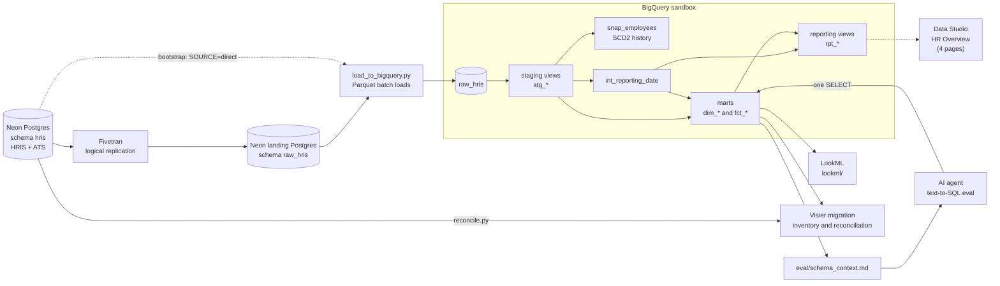

# Architecture

How the warehouse fits together: its layers and the rule each enforces, where problems are caught, how
it runs each night, and what changes with a production budget. It runs on free tiers with synthetic
data ([decisions.md](decisions.md)). Anything not in the repo is marked **not built here**.

## 1. Overview

Dotted lines aren't part of the nightly run: the bootstrap load (a stand-in used before the Fivetran
connection went live, kept for rebuilding from scratch) and the Data Studio HR Overview, which queries the
views when someone opens it. [dashboards.md](dashboards.md) shows how it's built.

The design goal is one people-analytics layer that HR, dashboards and AI agents can all query and get
the same, correct answer. The hard parts are settled once, in the warehouse: effective-dated history,
FTE-only headcount, the reporting date, a leaver counting on their last day. LookML, the Data Studio
views and the agent's context all read the same documented marts and [metric definitions](metric-definitions.md).

## 2. Layers

### Source
Postgres 18 on Neon, schema `hris`: five HRIS tables (employees, job history, positions, departments,
terminations) and three ATS tables (requisitions, applications, application stages), written by a
deterministic simulation that moves one business day per night ([D9](decisions.md#d9-the-source-data-is-a-deterministic-simulation-that-can-be-cut-at-any-date)).
**Rule:** the [data contract](data-contract-hris.md): names, types, allowed values, notice for breaking
changes, corrections made here and never in the warehouse. **Repo:** [generator/](../generator/),
[simulations/](../simulations/) (drift and failure drills).

### Ingestion
Fivetran replicates `hris` (logical replication, every 6 hours) into a second Neon database, schema
`raw_hris`, adding `_fivetran_synced` and `_fivetran_deleted`, and the loader copies each landed table
into BigQuery with a Parquet batch load. Before the connection went live, `make ingest SOURCE=direct`
copied the source straight to BigQuery and added the two columns itself (`_fivetran_synced` was then
the load time); it's kept for rebuilding from scratch. **Why two hops:** the GCP project is a BigQuery sandbox
with no billing account, so nothing can be charged, and Fivetran refuses sandbox destinations. Batch
loads work there; streaming and DML don't ([platform-notes.md](platform-notes.md), [D2](decisions.md#d2-fivetran-lands-in-a-neon-postgres-landing-database-a-batch-loader-moves-it-to-bigquery)).
**Rule:** copy as landed. Columns and types are read from Postgres each run, so a new column arrives
with the next load; unchanged tables are skipped; each table is labelled with its origin.
**Repo:** [load_to_bigquery.py](../ingestion/load_to_bigquery.py), [check_ingestion.py](../ingestion/check_ingestion.py).

### Raw
BigQuery dataset `raw_hris`: one table per source table, as landed plus `_loaded_at`, never
date-partitioned (the sandbox drops date partitions older than 60 days). **Rule:** only staging reads
it; contract tests and freshness run here. **Repo:** [_sources.yml](../dbt/models/staging/_sources.yml).

### Staging
One view per source table (`stg_hris__*`, `stg_ats__*`): trimmed text, decoded codes (`V` to
`voluntary`), reasons from a seed, `job_level` as `L4` whether the source sends `L4` or `4`.
**Rule:** one row per source row. Staging drops soft-deleted rows, never business rows: contractors,
interns and leavers stay, and business filters belong in the marts. The one other drop is a source
defect, a repeat application by the same candidate to the same requisition.
**Repo:** [dbt/models/staging/](../dbt/models/staging/).

### History
`snap_employees`: SCD Type 2 versions of `hris_employees` in system time, the only copy of that table's
history (business-dated job history reaches `dim_employee` from `hris_job_history`). **Rule:** no MERGE,
since the sandbox has no DML: the model rebuilds itself from its previous version plus what changed
(`create or replace table ... as select ... from {{ this }}`), and an unchanged rebuild is identical. It
refuses to run if staging has a duplicated `employee_id` or lost over 10% of the open versions.
**Repo:** [snap_employees.sql](../dbt/models/history/snap_employees.sql), [backup_history_table.sql](../dbt/macros/backup_history_table.sql).

### Marts
A star schema in dataset `analytics`:

| Model | Grain | Built as |
| --- | --- | --- |
| `dim_date` | one row per calendar day, 2023-01-01 to 2027-12-31 | table |
| `dim_org` | one row per department or team | table |
| `dim_employee` | one row per employee per job version (`valid_from`, `valid_to`) | table |
| `fct_headcount_daily` | one row per employment record per day employed, up to the reporting date | view ([D6](decisions.md#d6-dbt-models-are-designed-around-the-sandbox-limits)) |
| `fct_hires`, `fct_terminations` | one row per FTE hire; one row per FTE exit event | table |
| `fct_requisitions`, `fct_application_funnel` | one row per requisition; one row per application | table |

**Rule:** every mart states its grain, key, joins, exclusions and traps, and every column is documented.
Employee facts (headcount, hires, terminations) carry the `employee_key` in effect on the event date;
"today" is `int_reporting_date`, the latest business day the source covers. **Repo:**
[dbt/models/marts/](../dbt/models/marts/), [dbt/models/intermediate/](../dbt/models/intermediate/).

### Reporting views
`rpt_workforce_daily` (a dense grid of day, department, location and tenure band), `rpt_exits` and
`rpt_recruiting_funnel`, the sources for a Data Studio dashboard. **Rule:** Data Studio can't join
safely, so rows carry their names and periods. Measures are additive counts, plus per-row durations
(tenure at exit, days to hire and to fill) that are only averaged. No view stores a rate, so rates are
calculated fields, right under any filter. Tests reconcile the views with the marts, and the exposure
`hr_overview` puts the dashboard in the lineage. [dashboards.md](dashboards.md) describes its pages
and how to build it ([D7](decisions.md#d7-semantic-layer-and-bi-lookml-in-the-repo-data-studio-for-live-dashboards)).
**Repo:** [dbt/models/reporting/](../dbt/models/reporting/).

### Semantic layer (LookML)
A view per mart, three explores (Headcount, Attrition, Recruiting) and a dashboard. **Rule:** each
metric is defined once and reviewed in git; every join declares its relationship, so symmetric
aggregates handle fanout; Headcount requires a date range and Recruiting always filters on employment
type. Looker has no free tier, so `make validate-lookml` checks it offline ([D7](decisions.md#d7-semantic-layer-and-bi-lookml-in-the-repo-data-studio-for-live-dashboards)).
**Repo:** [lookml/](../lookml/), [scripts/validate_lookml.py](../scripts/validate_lookml.py).

### Documentation and AI context
Model and column descriptions in the dbt YAML, persisted to BigQuery; the agent's context,
[eval/schema_context.md](../eval/schema_context.md), generated from dbt's manifest and catalog plus the
metric definitions; the docs here, including the Visier [migration plan](visier-migration-plan.md) and
[reconciliation](reconciliation.md). **Rule:** the context is generated from the same YAML descriptions
dbt persists to BigQuery and from the columns in dbt's catalog, never written by hand; `make docs`
regenerates it and fails on any undocumented mart column. It is regenerated by hand, not nightly, so
it can fall behind a model change until someone runs `make docs`. **Repo:**
[build_schema_context.py](../scripts/build_schema_context.py), [check_doc_coverage.py](../scripts/check_doc_coverage.py).

## 3. Data quality and contracts

| Where | Check | Catches | Effect |
| --- | --- | --- | --- |
| Raw | [`schema_contract`](../dbt/tests/generic/schema_contract.sql) on every table | a column renamed, dropped, retyped; a new column | error; new column warns |
| Raw | no repeat (`req_id`, `candidate_id`) application, `effective_to >= effective_from`, exits match an employee, `job_level` format | duplicates, bad dates, orphans | error; format warns |
| Raw | freshness on `_fivetran_synced` for applications (warn 28 h, error 34 h) and job history (10 and 14 days); tables that can go a week unchanged have none | a stalled sync or loader | reported, never blocks |
| Ingestion | `make check-ingestion` (row counts at each hop) | a hop that's behind | runbook |
| Staging | keys unique and not null, `accepted_values` on coded columns | new codes, changed formats | error |
| History | guards in the model; one current version per employee | duplicated keys, truncated staging | refuses to build; error |
| Marts | versions contiguous and non-overlapping; headcount reaches the reporting date and reconciles month to month | broken history logic, gaps | error |
| Reporting | dense grid; matches the marts by cell | dashboards drifting from the marts | error |
| Docs, LookML | 100% mart column docs; `make validate-lookml` | undocumented columns, broken references | error, but run by hand, not nightly |

`make dbt-build` tests in DAG order, so a failed source test skips everything downstream and the marts
keep the last good build. The nightly run builds every model, then tests, because `snap_employees`
records a change only on a day it runs and sandbox tables must be rewritten before they expire.

**Fix at the source.** When a test finds bad data, the correction goes into the HR system and reaches
the warehouse through the normal load, so every consumer gets the same rows. The four planted defects
were caught before any mart was built and fixed that way ([data-quality.md](data-quality.md)). The one
warehouse-side mapping (department names in `dim_org`) flags each row it corrects, so a recurrence shows.

## 4. Operating it

**Nightly run** ([dbt.yml](../.github/workflows/dbt.yml), 01:23 UTC, never two at once):
1. `make ingest SOURCE=$INGEST_SOURCE`: `fivetran` (the landing schema to BigQuery); `direct` only
   for a bootstrap straight from the source.
2. `make dbt-nightly TARGET=prod`: seeds, every model, every test; runs even if the load failed.
3. `make freshness`: reported, never blocks. A stalled sync leaves the warehouse correct but old.
4. `make simulate-day`: the next HR business day at the source (off when `PAUSE_SIMULATION=true`).
5. `make storage-report RECORD=1`, then a run summary ([scripts/ci_summary.py](../scripts/ci_summary.py)).

**Dev and prod.** One project, three datasets: `raw_hris` (shared input), `dbt_dev` (`TARGET=dev`, the
default) and `analytics` (`TARGET=prod`, what every consumer reads). Both targets cap each query at
1 GB billed ([dbt/profiles.yml](../dbt/profiles.yml)).

**Idempotency and backup.** Loads replace whole tables and skip unchanged ones; dbt models are
`create or replace`; an unchanged history rebuild is identical. Only `make simulate-day` moves the
source each run, so set `PAUSE_SIMULATION` before a manual re-run. Before each prod build, a pre-hook
copies `snap_employees` to `snap_employees_prev` if it passes its own checks; restore by copying it
back (`create or replace table ... as select * from analytics.snap_employees_prev`). Time travel covers 7 days.

**Storage and expiry.** The sandbox has a lifetime limit of 10 GiB of storage, not refunded when data
is deleted ([docs](https://docs.cloud.google.com/bigquery/docs/sandbox)). Google doesn't say how it is
metered, so `make storage-report` takes the conservative reading: it records bytes written in
`raw_hris._storage_ledger` and projects when 5 and 10 GiB would be reached. Tables expire 60 days after
creation, so the nightly run rewrites them and the loader reloads any table within 14 days of expiry.
When something breaks, use the [schema drift](runbook-schema-drift.md) and
[sync failure](runbook-sync-failure.md) runbooks. Each drill (`make drill NAME=...`) is built and has
been run against the source; the sync-failure drills were run with the live Fivetran connection.

## 5. What changes at production scale (not built here)

None of this is in the repo. With billing enabled, in production I would:

- **Pricing and organization:** on-demand pricing or Enterprise or Enterprise Plus reservations, not
  Standard edition, which has no fine-grained security controls and no BI Engine
  ([docs](https://docs.cloud.google.com/bigquery/docs/editions-intro)); and projects under a Google
  Cloud organization, which data masking requires
  ([docs](https://docs.cloud.google.com/bigquery/docs/column-data-masking-intro)).
- **Ingestion:** point Fivetran at BigQuery and drop the landing database and loader. The dataset keeps
  the name `raw_hris`, so no model changes, but the raw contracts change: they drop `_loaded_at`, which
  only the loader adds, and take Fivetran's types. Fivetran maps decimals to BIGNUMERIC, FLOAT or
  STRING ([docs](https://fivetran.com/docs/destinations/bigquery)), so `salary_local` stops being
  NUMERIC and staging casts it back. Until the contracts are updated, every breaking contract test fails.
- **Incremental models:** `fct_headcount_daily` as an incremental table partitioned by `snapshot_date`
  and clustered on `department_id`, built with `insert_overwrite` or `microbatch` with a `lookback`
  ([docs](https://docs.getdbt.com/reference/resource-configs/bigquery-configs)). Each run rebuilds a
  lookback window, because HR back-dates exits and job changes (sized from `effective_from` against
  `updated_at` at the source), plus a periodic full rebuild. `require_partition_filter` would also bind
  every view, test and Looker query that reads the table
  ([docs](https://docs.cloud.google.com/bigquery/docs/querying-partitioned-tables)), so it comes with
  three changes: `rpt_workforce_daily` and the headcount tests get a constant
  `snapshot_date >= history_start_date` predicate; the Headcount explore's `unless` fields move from
  `dim_date` to snapshot-date dimensions in the fact's own view, since a filter on a joined table
  doesn't count; and the agent context says to filter on `snapshot_date`. The event facts follow if
  they grow.
- **History:** `snap_employees` becomes a dbt snapshot with `hard_deletes: invalidate`
  ([docs](https://docs.getdbt.com/reference/resource-configs/hard-deletes)), which closes a deleted
  record's version as the model does now. A snapshot has no equivalent of the model's guards, so the
  truncation and duplicate-key checks become error-severity tests run on staging before
  `dbt snapshot`, and the existing versions are migrated into the snapshot's columns once
  (`snapshot_meta_column_names` keeps the `valid_from` and `valid_to` names).
- **Environments and identities:** separate GCP projects for dev, CI and prod; a service account per
  workload (Fivetran writes raw; dbt reads raw and builds `analytics`; BI and the agent read the marts
  and `rpt_*` views); Workload Identity Federation in GitHub Actions instead of a stored key ([docs](https://docs.cloud.google.com/iam/docs/workload-identity-federation-with-deployment-pipelines));
  a replication-only source login ([D4](decisions.md#d4-identities-one-service-account-for-dbt-and-scripts-fivetran-gets-its-own-postgres-logins)).
  Under the section 6 design, dbt's account needs more than Data Editor: BigQuery Data Owner on
  `analytics`, or a custom role, for `bigquery.tables.setCategory` (setting policy tags, with
  `datacatalog.taxonomies.get`) and `bigquery.rowAccessPolicies.create` and `setIamPolicy`
  (re-creating row policies) ([docs](https://docs.cloud.google.com/bigquery/docs/column-level-security),
  [docs](https://docs.cloud.google.com/bigquery/docs/managing-row-level-security)); Fine-Grained Reader
  on the tags it reads; and a `TRUE` row policy on every protected table it reads. Without that
  policy, `snap_employees` would read zero open versions, pass its 10% guard (it compares with zero),
  rebuild history from staging alone, and the pre-hook would copy the empty read over
  `snap_employees_prev`. So the model and the backup macro also get a guard that fails when the
  previous table reads no rows but staging has some.
- **CI on pull requests** (today dbt tests run nightly; the docs coverage and LookML checks only by
  hand): `dbt build --select state:modified+ --defer` against the prod manifest in a per-PR dataset;
  Looker's CI validators (SQL, assert, content, LookML, style) on a Looker-hosted instance with CI
  enabled, run on each pull request through the CI GitHub app or when a dbt Cloud CI job finishes
  ([docs](https://docs.cloud.google.com/looker/docs/continuous-integration)); the docs coverage and
  offline LookML checks; a check that the committed `eval/schema_context.md` matches what `make docs`
  generates; and one that every explore has the row filter.
- **Orchestration:** dbt Cloud, Cloud Composer ([docs](https://docs.cloud.google.com/composer/docs/composer-3/composer-overview))
  or GitHub Actions, started when a Fivetran sync finishes rather than by the clock.
- **Cost controls:** `maximum_bytes_billed` is already on every dbt and eval query, and Looker caches by
  datagroup. Add custom daily query quotas per user and project, which exist only under on-demand
  pricing ([docs](https://docs.cloud.google.com/bigquery/docs/custom-quotas)), the partition filter
  above, and BI Engine for dashboards ([docs](https://docs.cloud.google.com/bigquery/docs/bi-engine-intro)).
  BI Engine doesn't accelerate queries on tables with row access policies
  ([docs](https://docs.cloud.google.com/bigquery/docs/using-row-level-security-with-features)) or
  queries with data masking in effect
  ([docs](https://docs.cloud.google.com/bigquery/docs/column-data-masking-intro)), so plan it with
  section 6.

## 6. HR data security and PII

The data is synthetic; the design treats it as real.

| Class | Columns | Where |
| --- | --- | --- |
| Identity | `first_name`, `last_name`, `email` | raw `hris_employees`, `stg_hris__employees`, `snap_employees` and `snap_employees_prev`, `dim_employee`, the agent context |
| Pseudonymous ids | `employee_id`, `person_id`, `manager_id`, `candidate_id` | most marts, `rpt_exits` |
| Sensitive | `salary_local`; `termination_type`, `reason_code`, `reason`, `regretted_flag` | salary: raw `hris_job_history`, `stg_hris__job_history`, `dim_employee`, the agent context; exits: raw `hris_terminations`, `stg_hris__terminations`, `fct_terminations`, `rpt_exits`, the agent context |
| Protected categories | none today (no gender, age, ethnicity or disability) | if added: own tag, never in `rpt_*` or the agent context |

Every model is also built in `dbt_dev`, so each column sits there too.

**In this repo:**
- **LookML rows:** every explore has an `access_filter` on `dim_org.division_name` from the user
  attribute `division`, so a division head sees only their division; an explore without one is
  unrestricted ([docs](https://docs.cloud.google.com/looker/docs/reference/param-explore-access-filter)).
- **LookML fields:** `salary_local` and `currency` require `access_grant: can_see_salary`, so only users
  whose `can_see_salary` attribute is `yes` get them ([docs](https://docs.cloud.google.com/looker/docs/reference/param-field-required-access-grants)).
  Both controls bind only users without the `develop` and `use_sql_runner` permissions: developers
  can change the model, and SQL Runner queries the connection directly
  ([docs](https://docs.cloud.google.com/looker/docs/access-control-and-permission-management)).
- **A separate service account,** `dbt-bigquery`, for dbt, the loader and the checks, never a personal
  login. Its roles (Data Editor, Job User) are project-wide: separate, not least-privilege.

These LookML controls are checked offline with `make validate-lookml` and apply to queries made
through Looker. The `rpt_*` views and direct BigQuery access have no row or column scope, which the
production design below adds.

**Production design (not built here):**
- **Column-level security:** policy tags (identity, compensation, exit details) set through
  dbt-bigquery's `policy_tags` column property. Only holders of Data Catalog Fine-Grained Reader on a
  tag read the column ([docs](https://docs.cloud.google.com/bigquery/docs/column-level-security-intro));
  Masked Reader holders get dynamic masking instead: email mask on `email`, nullify on names and
  salary ([docs](https://docs.cloud.google.com/bigquery/docs/column-data-masking-intro)). Counts and
  joins use `employee_id` and `person_id`. Not the SHA-256 hash rule on names: it is deterministic,
  so a short list of likely names can be hashed and matched back.
- **Row access policies** on the mart tables, `fct_headcount_daily` included once it is an
  incremental table (views inherit their source tables' policies; a table doesn't). Data masking
  works only with non-subquery policies ([docs](https://docs.cloud.google.com/bigquery/docs/row-level-security-intro)),
  so a policy can't look the user up in an entitlement table. Instead dbt writes `division_name` onto
  each protected row, and each division has a policy granted to its Google group
  (`filter using (division_name = 'Engineering')`). A principal outside every policy sees no rows, so
  HR and service accounts need a `TRUE` policy ([docs](https://docs.cloud.google.com/bigquery/docs/row-level-security-intro));
  overlapping policies combine as a union ([docs](https://docs.cloud.google.com/bigquery/docs/managing-row-level-security)).
  Views such as `rpt_*` are filtered by their source tables' policies
  ([docs](https://docs.cloud.google.com/bigquery/docs/using-row-level-security-with-features)).
- **Rebuilds drop policies.** dbt's table materialization runs `create or replace table`, which drops
  every row access policy and policy tag on the old table, even when the new table is built from its
  data ([docs](https://docs.cloud.google.com/bigquery/docs/row-level-security-intro),
  [docs](https://docs.cloud.google.com/bigquery/docs/column-level-security-intro)). dbt-bigquery puts
  the tags back after each build through `persist_docs` (on in this project), so columns are untagged
  for a moment, and stay untagged if that step fails. Nothing puts row policies back, so after the
  first nightly build anyone with Data Viewer would see every row. Each protected model therefore
  re-creates its policies in a post-hook, or is incremental, since a MERGE keeps them (its first build
  and any full refresh still replace the table); a post-hook leaves the table open between the replace
  and the hook. A check after the build fails if any protected table is missing its policies or tags.
  The `snap_employees` backup and restore become copy jobs, which carry the source's row policies, in
  place of `create table ... as select`.
- **How identity reaches BigQuery.** Row policies see the principal running the query
  ([`SESSION_USER()`](https://docs.cloud.google.com/bigquery/docs/reference/standard-sql/security_functions)),
  and a shared service account is one principal. With a service-account connection, Looker's account
  gets a `TRUE` policy and `access_filter` is the row control. With an OAuth connection each user
  queries as themselves, so BigQuery's policies apply per user, and so does Looker's cache
  ([docs](https://docs.cloud.google.com/looker/docs/db-config-google-bigquery)). A scoped Data Studio
  report would switch from owner's to viewer's credentials
  ([docs](https://docs.cloud.google.com/looker/docs/studio/data-credentials)).
- **Authorized views** in a separate dataset for consumers who should see only aggregates
  ([docs](https://docs.cloud.google.com/bigquery/docs/authorized-views)), and a minimum group size on
  exit reasons, regretted exits and pay, since an average over two people identifies them. An
  authorized view skips table and dataset IAM but not policy tags: the tags on the underlying columns
  still decide access ([docs](https://docs.cloud.google.com/bigquery/docs/column-level-security-intro)).
  So dbt builds the pay aggregates, small cells suppressed, into an untagged table that the view
  reads; otherwise every consumer of the view needs Fine-Grained Reader on the compensation tag.
- **Least privilege and audit:** BigQuery Data Viewer on the marts and `rpt_*` views, not on all of
  `analytics`, because `snap_employees` and `snap_employees_prev` sit there too; or move both to a
  `history` dataset that no consumer is granted ([docs](https://docs.cloud.google.com/bigquery/docs/access-control)).
  Raw readable only by dbt. A view that isn't authorized needs its reader to have access to every
  table under it ([docs](https://docs.cloud.google.com/bigquery/docs/column-level-security-intro)), and
  `int_reporting_date` reads raw through staging, so it becomes a one-row table granted with the
  marts; otherwise `rpt_workforce_daily` and today's `fct_headcount_daily` view would fail for every
  consumer. BigQuery's data access audit logs are on by default
  ([docs](https://docs.cloud.google.com/logging/docs/audit/configure-data-access)); keep them in a
  bucket with its own retention and review reads of tagged columns.
- **Retention:** a source delete is not an erasure here. With Fivetran the row stays in raw with
  `_fivetran_deleted = true`, and `snap_employees` and its backup keep every past name and email.
  Production needs retention periods agreed per country of employment (staff are in India, the UK,
  Singapore and the US; Remote staff have no country recorded, so the HRIS needs that field first), a
  scheduled purge of raw, history and the backup (DML, so billing), and default table expiration on
  dev and CI datasets ([docs](https://docs.cloud.google.com/bigquery/docs/updating-datasets)). Purged
  rows stay recoverable for the time travel window (2 to 7 days, set per dataset) plus 7 days of
  fail-safe, which can't be shortened ([docs](https://docs.cloud.google.com/bigquery/docs/time-travel)),
  so history datasets get a 2-day window if the retention policy needs it. Once a table has had row
  policies, only principals with `bigquery.rowAccessPolicies.overrideTimeTravelRestrictions` (in
  BigQuery Admin, not in the basic Owner role) can read its past versions, so the time-travel restore
  in section 4 needs that role.

## 7. AI agent access

**In this repo:** the agent gets [eval/schema_context.md](../eval/schema_context.md), the documented
marts and metric definitions only; raw, staging and history aren't described. It must answer with one
SELECT. [eval/run_eval.py](../eval/run_eval.py) dry-runs the SQL, runs it only if BigQuery reports a
SELECT, and caps it at 1 GiB (`maximum_bytes_billed`) and a timeout. The model gets no tools, and a
canary check confirms it can't read the repo. The eval scores answers against gold queries
([eval/questions.yaml](../eval/questions.yaml)) with bare, documented and improved context, and keeps
each run in [eval/results/](../eval/results/).

**Production design (not built here):** its own service account with BigQuery Data Viewer on the
marts and `rpt_*` views only, plus Job User (here it runs as `dbt-bigquery`, so the SELECT-only dry
run is what keeps it read-only); no grant on `raw_hris` or history, and no Fine-Grained Reader on
identity or compensation tags, so those queries fail and those columns leave the context (today it
lists names, email and salary, all synthetic). That account is one principal, so it can't carry each
asker's row scope. Either each query runs with the asking user's OAuth credentials, so BigQuery
applies that user's row policies, or the account gets a `TRUE` policy and the agent queries through a
layer that scopes rows itself, such as Looker's API with `access_filter`, which BigQuery doesn't
enforce. Every query and its bytes logged.

## 8. Key trade-offs

| Decision | Gained | Given up |
| --- | --- | --- |
| BigQuery sandbox, no billing ([D1](decisions.md#d1-bigquery-sandbox-a-project-with-no-billing-account)) | spend is impossible, not just alerted on | DML, date partitions, tables past 60 days, over 10 GiB of storage |
| Fivetran to Postgres, batch loader to BigQuery ([D2](decisions.md#d2-fivetran-lands-in-a-neon-postgres-landing-database-a-batch-loader-moves-it-to-bigquery)) | real CDC, drift and failure behaviour | one more hop to run and monitor |
| Postgres source, not Sheets ([D3](decisions.md#d3-source-system-free-neon-postgres-not-google-sheets)) | typed columns and CDC, so every drill is real | a replication slot Neon drops after ~40 hours without progress |
| One service account for dbt and scripts ([D4](decisions.md#d4-identities-one-service-account-for-dbt-and-scripts-fivetran-gets-its-own-postgres-logins)) | simple, no personal logins | not least-privilege |
| Self-rebuilding SCD2, not `dbt snapshot` ([D6](decisions.md#d6-dbt-models-are-designed-around-the-sandbox-limits)) | history without MERGE | the table is the only copy, hence the guards and backup |
| Headcount fact as a view ([D6](decisions.md#d6-dbt-models-are-designed-around-the-sandbox-limits)) | no storage, never behind the other marts | computed per query; Looker requires a date range |
| LookML offline, Data Studio for live dashboards ([D7](decisions.md#d7-semantic-layer-and-bi-lookml-in-the-repo-data-studio-for-live-dashboards)) | a reviewed semantic layer at no cost | Looker's own validator and its enforcement of the access controls; Data Studio can't join, so it needs shaped views |
| Deterministic simulated source ([D9](decisions.md#d9-the-source-data-is-a-deterministic-simulation-that-can-be-cut-at-any-date)) | changes daily yet reproduces exactly | generator dependencies pinned |
